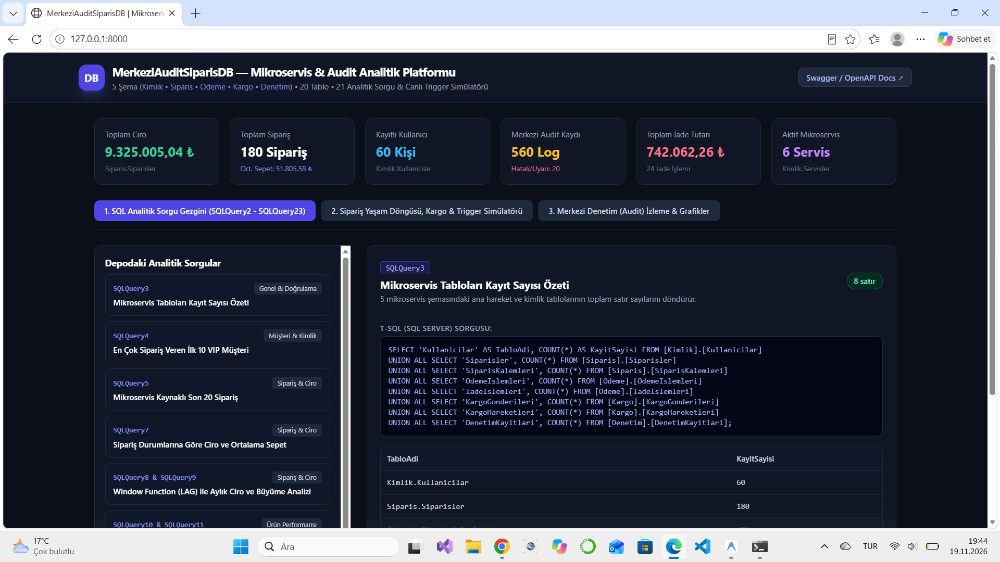
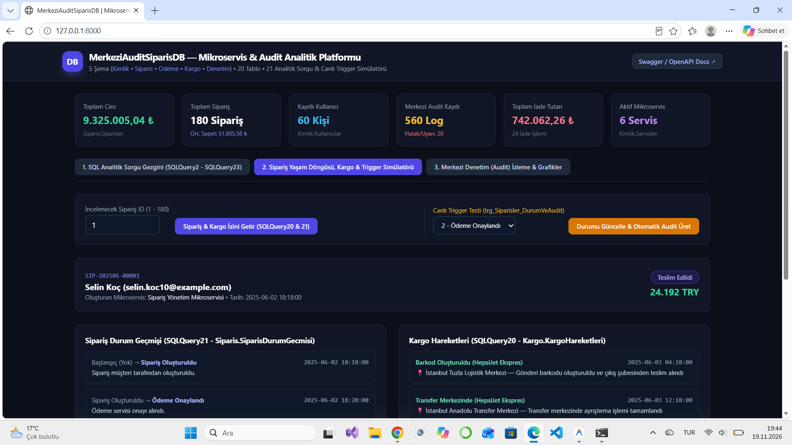
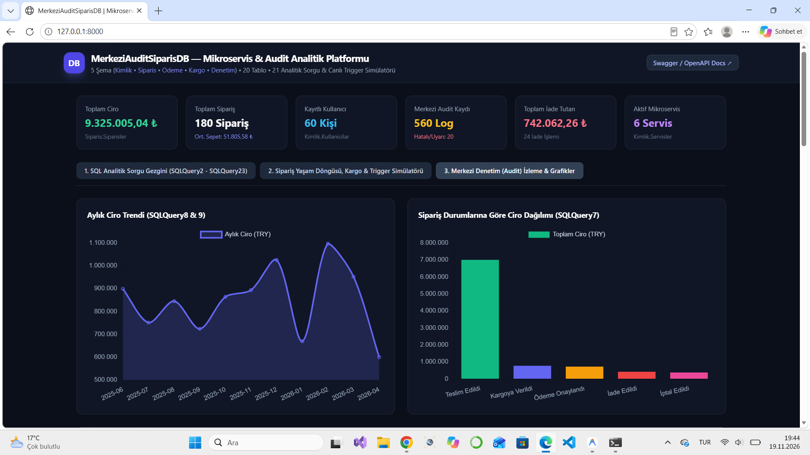
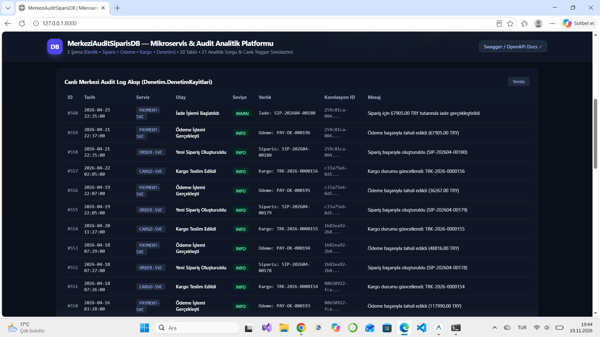
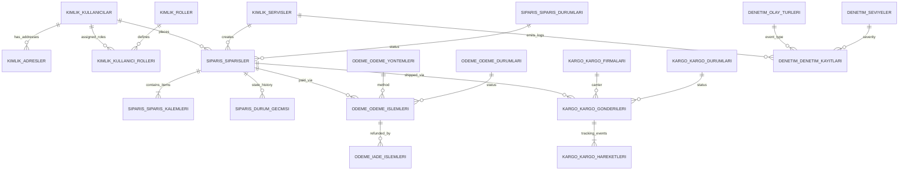

# 🏛️ Microservice Order & Centralized Audit Database Architecture and Analytics Platform

<div align="center">

[](./README.en.md)
[](./README.md)

[-CC2927?style=flat-square&logo=microsoftsqlserver&logoColor=white)](#)
[-009688?style=flat-square&logo=fastapi&logoColor=white)](#)
[](#)
[](#)

</div>

> 🇹🇷 **Türkçe Dokümantasyon:** Bu dokümantasyonun Türkçe versiyonu için **[README.md](./README.md)** dosyasına göz atabilirsiniz.

**`MerkeziAuditSiparisDB`** is an end-to-end **Enterprise Database Architecture, Data Analytics, and Centralized Observability/Audit Platform** designed for microservice ecosystems. It models five core Bounded Contexts — **Identity (`[Kimlik]`)**, **Order Management (`[Siparis]`)**, **Payment & Refunds (`[Odeme]`)**, **Shipping & Logistics (`[Kargo]`)**, and **Centralized Audit & Tracing (`[Denetim]`)** — using schema-isolated relational database design, automated triggers, 21 analytical queries, and an interactive **FastAPI** dashboard.

---

## 📸 Platform Screenshots (Live Analytics Dashboard)

### 1. SQL Analytics Query Explorer & Executive KPIs (`SQLQuery2` – `SQLQuery23`)
> Real-time executive KPIs across 5 microservice schemas and 20 relational tables, displaying both the underlying T-SQL query and live query execution results.


### 2. Order Lifecycle, Shipment Tracking & Live Trigger Simulator
> Step-by-step order state transition history (`SQLQuery21`), shipment tracking timeline (`SQLQuery20`), and a live simulator that fires the `[Siparis].[trg_Siparisler_DurumVeAudit]` database trigger.


### 3. Monthly Revenue Growth (`LAG` Window Function) & Order Status Distribution Charts
> Interactive Chart.js visualizations powered by `SQLQuery8`, `SQLQuery9` (month-over-month revenue growth via `LAG()`), and `SQLQuery7`.


### 4. Live Centralized Audit Log Stream (`Denetim.DenetimKayitlari`)
> Real-time centralized audit stream capturing events across `ORDER-SVC`, `PAYMENT-SVC`, `CARGO-SVC`, and `AUDIT-SVC` with distributed tracing `CorrelationID` (`KorelasyonID`) and JSON payloads.


---

## 🎯 Architecture & Key Highlights

1. **5 Microservice Bounded-Context Schemas & 20 Relational Tables (`sql/01_schema_and_tables.sql`)**:
   - **`[Kimlik]` (Identity & Service Registry)**: `Kullanicilar`, `Roller`, `KullaniciRolleri`, `Adresler`, `Servisler`
   - **`[Siparis]` (Order Management)**: `SiparisDurumlari`, `Siparisler`, `SiparisKalemleri`, `SiparisDurumGecmisi`
   - **`[Odeme]` (Payments & Refunds)**: `OdemeYontemleri`, `OdemeDurumlari`, `OdemeIslemleri`, `IadeIslemleri`
   - **`[Kargo]` (Shipping & Logistics)**: `KargoFirmalari`, `KargoDurumlari`, `KargoGonderileri`, `KargoHareketleri`
   - **`[Denetim]` (Centralized Audit & Observability)**: `OlayTurleri`, `Seviyeler`, `DenetimKayitlari`
2. **Performance & Covering Indexes (`sql/02_indexes_and_constraints.sql`)**:
   - Optimized `NONCLUSTERED` and `INCLUDE` (*Covering*) indexes for high-throughput order queries, financial aggregations, and distributed tracing (`KorelasyonID`) lookups.
3. **Automated State History & Centralized Audit Triggers (`sql/03_triggers_and_procedures.sql`)**:
   - `[Siparis].[trg_Siparisler_DurumVeAudit]`: Automatically records state transitions into `[Siparis].[SiparisDurumGecmisi]` and emits a structured JSON audit event with a `KorelasyonID` into `[Denetim].[DenetimKayitlari]` whenever an order's status changes.
   - Includes `[Denetim].[usp_DenetimKaydiEkle]` and `[dbo].[usp_BulkImportCsv]` stored procedures.
4. **21 Enterprise Data Analytics & Financial Reconciliation Queries (`sql/05_analytics_views_and_queries.sql`)**:
   - Month-over-Month revenue growth analysis using `LAG()` Window Functions (`SQLQuery9`)
   - Automated Financial Reconciliation detecting discrepancies between Order Header `AraToplam` and Line Items `SUM(SatirToplami)` (`SQLQuery23`)
   - SLA monitoring for paid orders awaiting shipment dispatch (`SQLQuery19`)
   - VIP customer segmentation (`SQLQuery4`), inactive user churn detection (`SQLQuery13`), payment failure root-cause analysis (`SQLQuery15`), and refund analytics (`SQLQuery17`).
5. **Synthetic Data & 20-CSV Dataset Generator (`scripts/generate_data.py`)**:
   - Generates 20 referential-integrity-compliant UTF-8 CSV files (`data/csv/`) ready for SQL Server `BULK INSERT` alongside a pre-populated SQLite analytics database (`data/merkezi_audit_siparis.db`).
6. **FastAPI REST API & Interactive Dark-Mode Dashboard (`app/main.py` & `app/dashboard.html`)**:
   - Full REST API (`/api/overview`, `/api/queries`, `/api/orders/{id}/timeline`, `/api/audit-logs`), Swagger/OpenAPI documentation (`/docs`), and a live database trigger simulator.

---

## 🗺️ Entity-Relationship (ER) Diagram



---

## 📂 Project Directory Structure

```text
MikroServisSipai-veAuditSistemi/
├── app/
│   ├── main.py                            # FastAPI REST API & Trigger Simulation Service
│   └── dashboard.html                     # Interactive Dark-Mode Analytics Dashboard
├── data/
│   ├── csv/                               # 20 UTF-8 CSV Datasets for MSSQL Bulk Import
│   └── merkezi_audit_siparis.db           # Pre-built SQLite Database for Live Dashboard
├── docs/
│   └── screenshots/                       # Application UI Screenshots
├── scripts/
│   └── generate_data.py                   # Synthetic Data Generator (20 CSVs + SQLite DB)
├── sql/
│   ├── 01_schema_and_tables.sql           # Complete T-SQL DDL for 5 Schemas & 20 Tables
│   ├── 02_indexes_and_constraints.sql     # Non-Clustered & Covering Performance Indexes
│   ├── 03_triggers_and_procedures.sql     # Automated Audit Triggers & Stored Procedures
│   ├── 04_csv_bulk_import.sql             # Transactional CSV Bulk Import Script
│   └── 05_analytics_views_and_queries.sql # 21 Categorized Analytical Queries (SQLQuery2..23)
├── Dockerfile
├── docker-compose.yml
├── requirements.txt
├── README.md                              # Turkish Documentation (Türkçe Dokümantasyon)
└── README.en.md                           # English Documentation
```

---

## 🚀 Getting Started

### 1. Run with Python (FastAPI) & Live Analytics Dashboard
```bash
# 1. Install dependencies
pip install -r requirements.txt

# 2. (Optional) Regenerate the 20 CSV files and SQLite database
python scripts/generate_data.py

# 3. Start the FastAPI server
uvicorn app.main:app --reload --port 8000
```
- **Interactive Analytics Dashboard:** `http://127.0.0.1:8000`
- **Swagger / OpenAPI Documentation:** `http://127.0.0.1:8000/docs`

### 2. Run on Microsoft SQL Server (SSMS / Azure Data Studio)
1. Copy the 20 CSV files from `data/csv/` into `C:\CSVImport\` (or update the `@BasePath` variable in `sql/04_csv_bulk_import.sql`).
2. Execute the T-SQL scripts inside `sql/` in order:
   - `01_schema_and_tables.sql`
   - `02_indexes_and_constraints.sql`
   - `03_triggers_and_procedures.sql`
   - `04_csv_bulk_import.sql`
   - `05_analytics_views_and_queries.sql`

### 3. Run with Docker Compose
```bash
docker compose up --build
```
