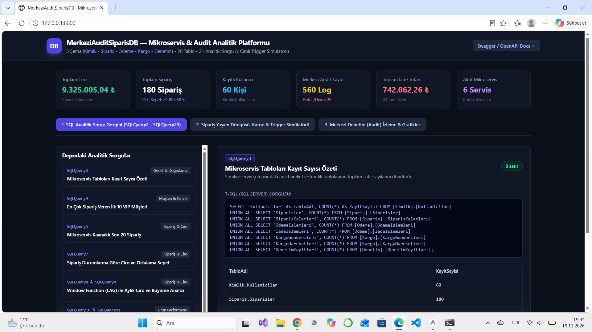
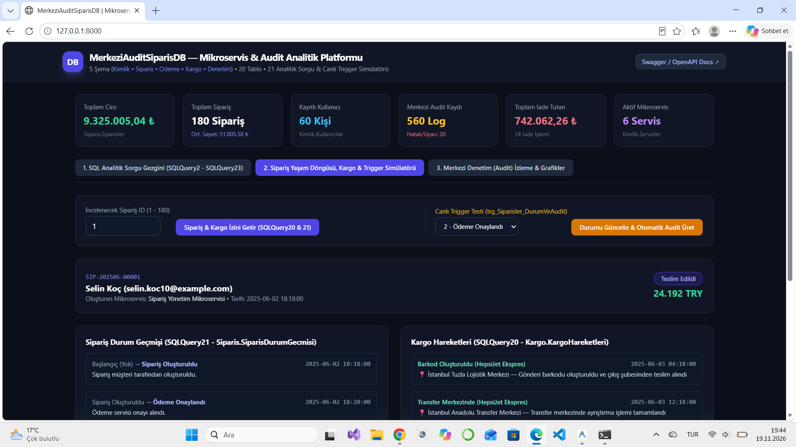
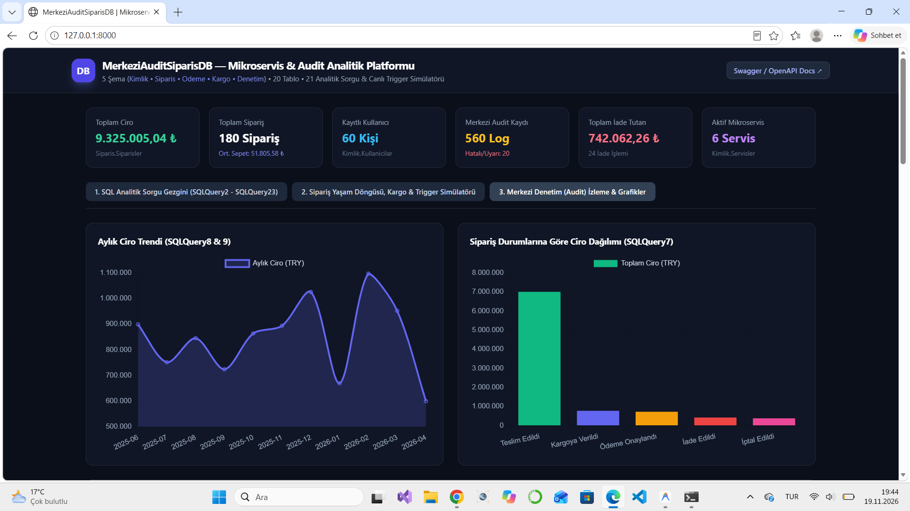
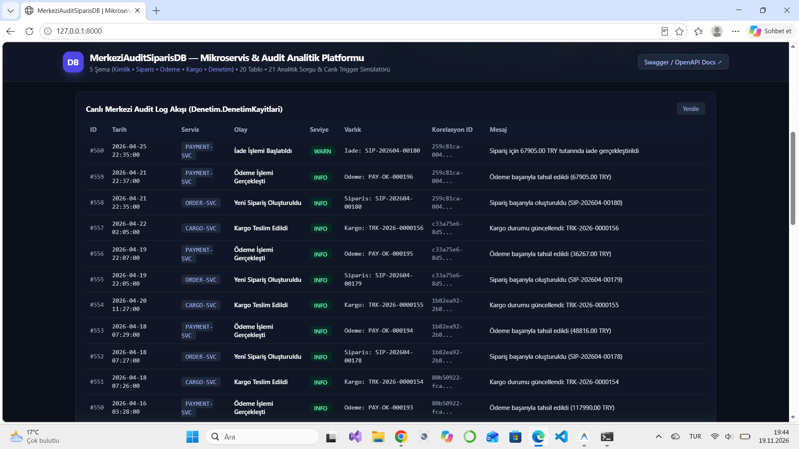
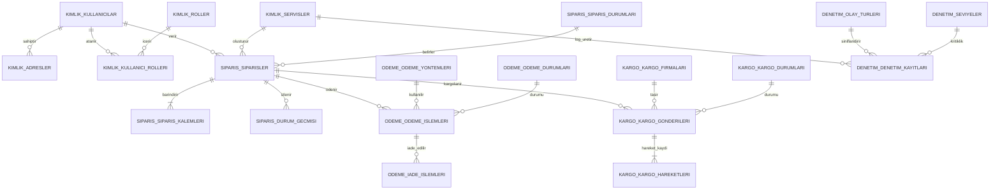

# 🏛️ Mikroservis Sipariş ve Merkezi Denetim (Audit) Veritabanı & Analitik Platformu

<div align="center">

[](./README.md)
[](./README.en.md)

[-CC2927?style=flat-square&logo=microsoftsqlserver&logoColor=white)](#)
[-009688?style=flat-square&logo=fastapi&logoColor=white)](#)
[](#)
[](#)

</div>

> 🌍 **English Documentation:** For the full English version of this documentation, please visit **[README.en.md](./README.en.md)**.

**`MerkeziAuditSiparisDB`**, mikroservis mimarilerinde **Kimlik (Identity)**, **Sipariş (Order)**, **Ödeme & İade (Payment & Refund)**, **Kargo & Lojistik (Shipping & Logistics)** ve **Merkezi Denetim (Centralized Audit & Observability)** bağlamlarını (*Bounded Contexts*) şema bazlı izole edilmiş kurumsal bir veritabanı mimarisiyle modelleyen uçtan uca bir **Veritabanı Mimarisi, Veri Analitiği ve Canlı Gözlemlenebilirlik (Observability)** platformudur.

---

## 📸 Uygulama Ekran Görüntüleri (Canlı Analitik Dashboard)

### 1. SQL Analitik Sorgu Gezgini & KPI Özeti (`SQLQuery2` – `SQLQuery23`)
> 5 mikroservis şemasındaki 20 tablonun canlı KPI metrikleri, T-SQL sorgu kodları ve anlık sorgu sonuç tabloları.


### 2. Sipariş Yaşam Döngüsü, Kargo Hareketleri & Canlı Trigger Simülatörü
> Seçilen siparişin adım adım durum geçmişi (`SQLQuery21`), kargo transfer hareketleri (`SQLQuery20`) ve `[Siparis].[trg_Siparisler_DurumVeAudit]` trigger'ını canlı tetikleyen simülasyon paneli.


### 3. Aylık Ciro Büyüme Trendi (`LAG` Window Function) ve Durum Dağılım Grafikleri
> `SQLQuery8`, `SQLQuery9` ve `SQLQuery7` sorgularından beslenen interaktif aylık ciro ve sipariş durumu grafikleri.


### 4. Canlı Merkezi Denetim (Audit) Log Akışı (`Denetim.DenetimKayitlari`)
> Mikroservislerin (`ORDER-SVC`, `PAYMENT-SVC`, `CARGO-SVC`, `AUDIT-SVC`) ürettiği `KorelasyonID` (Distributed Tracing) destekli merkezi denetim kayıtları.


---

## 🎯 Mimari ve Öne Çıkan Özellikler

1. **5 Mikroservis Şeması & 20 İlişkisel Tablo (`sql/01_schema_and_tables.sql`)**:
   - **`[Kimlik]`**: `Kullanicilar`, `Roller`, `KullaniciRolleri`, `Adresler`, `Servisler`
   - **`[Siparis]`**: `SiparisDurumlari`, `Siparisler`, `SiparisKalemleri`, `SiparisDurumGecmisi`
   - **`[Odeme]`**: `OdemeYontemleri`, `OdemeDurumlari`, `OdemeIslemleri`, `IadeIslemleri`
   - **`[Kargo]`**: `KargoFirmalari`, `KargoDurumlari`, `KargoGonderileri`, `KargoHareketleri`
   - **`[Denetim]`**: `OlayTurleri`, `Seviyeler`, `DenetimKayitlari`
2. **Performans & Covering İndeksler (`sql/02_indexes_and_constraints.sql`)**:
   - Yüksek hacimli analitik ve operasyonel sorgular ile `KorelasyonID` aramaları için `NONCLUSTERED` ve `INCLUDE` (*Covering*) indeksler.
3. **Otomatik Durum Geçmişi & Merkezi Audit Trigger'ları (`sql/03_triggers_and_procedures.sql`)**:
   - `[Siparis].[trg_Siparisler_DurumVeAudit]`: Sipariş durumu güncellendiğinde otomatik olarak hem `[Siparis].[SiparisDurumGecmisi]` tablosuna kayıt ekler hem de `[Denetim].[DenetimKayitlari]` tablosuna `JSON` payload ve `KorelasyonID` ile denetim izi düşer.
   - `[Denetim].[usp_DenetimKaydiEkle]` ve `[dbo].[usp_BulkImportCsv]` Stored Procedure'leri.
4. **21 Kurumsal Veri Analitiği & Finansal Mutabakat Sorgusu (`sql/05_analytics_views_and_queries.sql`)**:
   - `LAG()` Window Function ile aylık ciro büyüme analizi (`SQLQuery9`)
   - Finansal mutabakat / tutarsızlık denetimi (`AraToplam` vs `SUM(SatirToplami)` - `SQLQuery23`)
   - Ödemesi alınmış ancak henüz kargoya verilmemiş SLA/operasyon takibi (`SQLQuery19`)
   - VIP müşteri analizi (`SQLQuery4`), pasif kullanıcı (Churn) tespiti (`SQLQuery13`), başarısız ödeme hata analizi (`SQLQuery15`) ve iade raporları (`SQLQuery17`).
5. **Sentetik Veri & 20 CSV Üretici (`scripts/generate_data.py`)**:
   - Tek komutla `04_csv_bulk_import.sql` ile birebir uyumlu **20 adet UTF-8 CSV** dosyasını (`data/csv/`) ve yerel analitik veritabanını (`data/merkezi_audit_siparis.db`) üretir.
6. **FastAPI Backend & İnteraktif Analitik Dashboard (`app/main.py` & `app/dashboard.html`)**:
   - REST API uç noktaları (`/api/overview`, `/api/queries`, `/api/orders/{id}/timeline`, `/api/audit-logs`), Swagger/OpenAPI arayüzü (`/docs`) ve modern karanlık mod dashboard.

---

## 🗺️ Veritabanı ER Diyagramı (Entity-Relationship)



---

## 📂 Proje Dizin Yapısı

```text
MicroserviceOrderAudit/
├── app/
│   ├── main.py                            # FastAPI REST API & Trigger Simülasyon Servisi
│   └── dashboard.html                     # İnteraktif Karanlık Mod Analitik Dashboard
├── data/
│   ├── csv/                               # MSSQL Bulk Import Uyumlu 20 Adet UTF-8 CSV Veri Seti
│   └── merkezi_audit_siparis.db           # Canlı Dashboard için Hazır Veritabanı
├── docs/
│   └── screenshots/                       # Canlı Uygulama Ekran Görüntüleri
├── scripts/
│   └── generate_data.py                   # 20 CSV Dosyası ve SQLite Veritabanı Üretici Script
├── sql/
│   ├── 01_schema_and_tables.sql           # 5 Şema ve 20 Tablonun Tam T-SQL DDL Tanımları
│   ├── 02_indexes_and_constraints.sql     # Performans ve Covering İndeksler
│   ├── 03_triggers_and_procedures.sql     # Otomatik Audit Trigger ve Stored Procedure'ler
│   ├── 04_csv_bulk_import.sql             # 20 CSV Dosyası için Transactional Bulk Import
│   └── 05_analytics_views_and_queries.sql # Kategorize Edilmiş 21 Analitik Sorgu (SQLQuery2..23)
├── Dockerfile
├── docker-compose.yml
├── requirements.txt
├── README.md                              # Türkçe Dokümantasyon
└── README.en.md                           # İngilizce Dokümantasyon (English Documentation)
```

---

## 🚀 Kurulum ve Çalıştırma

### 1. Python (FastAPI) & Canlı Analitik Dashboard'u Çalıştırma
```bash
# 1. Bağımlılıkları yükleyin
pip install -r requirements.txt

# 2. (Opsiyonel) 20 CSV dosyasını ve veritabanını yeniden üretin
python scripts/generate_data.py

# 3. FastAPI sunucusunu başlatın
uvicorn app.main:app --reload --port 8000
```
- **Canlı Analitik Dashboard:** `http://127.0.0.1:8000`
- **Swagger / OpenAPI Dokümantasyonu:** `http://127.0.0.1:8000/docs`

### 2. SQL Server (SSMS / Azure Data Studio) Üzerinde Çalıştırma
1. `data/csv/` klasöründeki 20 adet CSV dosyasını `C:\CSVImport\` dizinine kopyalayın (veya `04_csv_bulk_import.sql` içindeki `@BasePath` değişkenini kendi klasör yolunuza göre güncelleyin).
2. `sql/` klasöründeki scriptleri sırasıyla çalıştırın:
   - `01_schema_and_tables.sql`
   - `02_indexes_and_constraints.sql`
   - `03_triggers_and_procedures.sql`
   - `04_csv_bulk_import.sql`
   - `05_analytics_views_and_queries.sql`

### 3. Docker ile Çalıştırma
```bash
docker compose up --build
```
